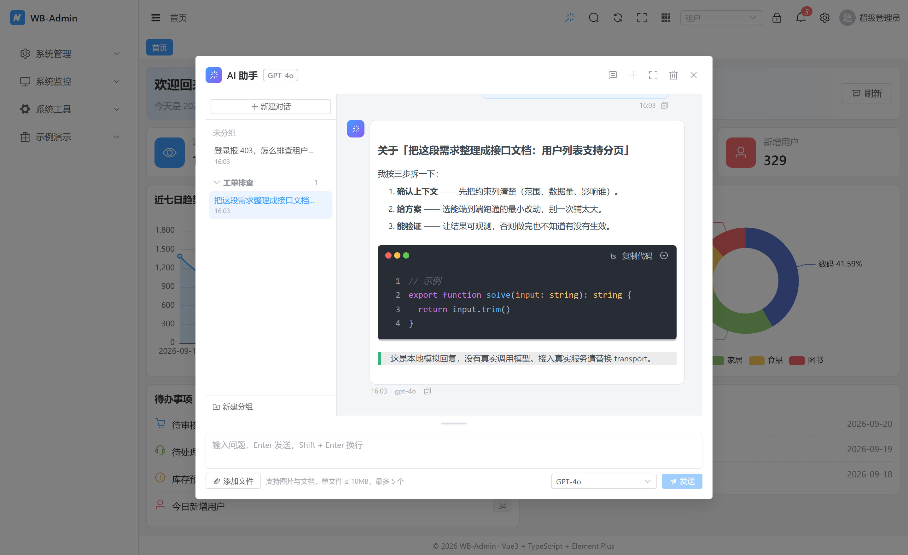

# AiChat AI 对话助手

全局 AI 对话面板：顶栏 ✨ 图标或 `Ctrl + I` 唤起，**多会话 + 分组管理**（新建 / 切换 / 重命名 / 删除 / 按分组归类），附件随消息发送、模型切换、历史按登录人持久化，支持全屏与拖动调整输入框高度；回复中的 ` ```mermaid ` 代码块渲染成流程图。

**直连 Ollama**（`/api/tags` + `/api/chat`，非流式），接口与其他业务接口一样走 axios（`src/api/ai.ts`）。



本页给两类人看：

- 前端：从零复刻这个面板，或把它接到自己的项目里；
- 后端：当前直连 Ollama（`/api/tags` + `/api/chat`，非流式 JSON）；文末另附一份「换成自研后端」的接口契约供参考。

## 目录与职责

| 文件 | 职责 |
| --- | --- |
| `src/api/ai.ts` | 接口层：Ollama 的 `/api/tags`（模型列表）与 `/api/chat`（对话），与其他接口一样走 axios |
| `src/components/AiChat/useAiChat.ts` | 全局会话状态（模块级单例）：会话与分组、发送 / 停止 / 清空 / 附件校验 / 历史持久化 / 模型列表归一化 |
| `src/components/AiChat/index.vue` | 弹窗 UI：会话侧栏、消息列表、Markdown 渲染、附件区、模型选择、拖动条 |
| `src/layouts/components/Navbar/index.vue` | 顶栏入口图标 |
| `src/layouts/index.vue` | 挂载弹窗 + `Ctrl + I` 快捷键 |
| `src/types/index.ts` | `AiModel` / `ChatMessage` / `ChatAttachment` / `ChatGroup` / `ChatSession` |
| `src/mock/index.ts` | 业务数据 mock（登录、列表、字典、设备树、看板等）；**不含 AI 接口** —— AI 直接打真实 Ollama |
| `test/unit/ai-chat.spec.ts` | 请求体字段、abort 收尾、附件限额、历史隔离、会话分组与 v1 迁移 |
| `test/e2e/ai-chat.spec.ts` | 真实浏览器交互回归（含新建对话、建组、移动、折叠、刷新保持） |

## 数据流

```
点击发送
  └─ useAiChat.send()
       ├─ 固定当前会话 id（sid）—— 之后所有写入都认这个 id，不认「当前会话」
       ├─ 先取历史（必须在推入本条之前取，否则最后一条会重复发）
       ├─ 本地插入 user 消息 → 清空输入框与待发附件 → 首条消息顺便生成标题
       ├─ 插入 assistant 占位消息（pending: true）
       └─ await aiApi.chat(body, signal)     // axios，等模型生成完一次性返回
            ├─ resolve → 把 message.content 写进 sid 的占位消息 → pending = false
            └─ reject → error = true + composer 上方错误条（中断不算失败）
```

界面只认 `aiApi` 这两个方法，接口协议（Ollama / 自研网关 / 厂商 SDK）全部收敛在 `src/api/ai.ts` 一处。

---

## 一、前端实现步骤

### 1. 先定类型

```ts
export type ChatRole = 'user' | 'assistant'

export interface AiModel {
  id: string
  name: string
  provider?: string   // 下拉里做副标题
  context?: number    // 上下文窗口（token）
  desc?: string
  disabled?: boolean  // 下线但不删，避免历史里选过的模型彻底消失
}

export interface ChatAttachment {
  uid: string         // 本地唯一 id，列表 key 与移除用
  name: string
  size: number
  type: string        // MIME，图标展示用
  file?: File         // 只在内存里，绝不落盘
  url?: string        // 走真实后端时回填
}

export interface ChatMessage {
  id: string
  role: ChatRole
  content: string
  model?: string
  attachments?: ChatAttachment[]
  time: number
  pending?: boolean   // 生成中（请求未返回）
  error?: boolean     // 本条生成失败
}

/** 会话分组。未分组不是一条记录，用 groupId: '' 表示 */
export interface ChatGroup {
  id: string
  name: string
  collapsed?: boolean  // 折叠状态也持久化
  createdAt: number
}

/** 一个独立会话，各自持有消息、模型与归属分组 */
export interface ChatSession {
  id: string
  title: string        // 首条消息截断生成，也可手动改名；空串 = 新对话
  groupId: string      // '' = 未分组
  messages: ChatMessage[]
  model?: string
  createdAt: number
  updatedAt: number    // 列表排序依据
}
```

### 2. 接口层只有两个方法

```ts
// src/api/ai.ts —— 与其他接口一样走 axios（http 封装），这里只声明、不含逻辑
export const aiApi = {
  tags: () => http.get<OllamaTagsBody>('/tags', undefined, { showError: false }),
  chat: (body: OllamaChatBody, signal?: AbortSignal) =>
    http.post<OllamaChatResult>('/chat', body, { showError: false, repeatable: true }, { signal, timeout: 0 })
}
```

两个 meta 要注意：`showError: false` 让失败只体现在面板的红字里（不弹全局 ElMessage）；`repeatable: true` 让「停止」按钮的 `signal` 生效 —— 否则会被防重复提交的 controller 覆盖。`timeout: 0` 是因为实例默认 30s 不够模型生成。

逻辑（打开面板时拉模型列表、点发送时调 chat）全部在 `useAiChat` 里：单测直接 spy 掉 `aiApi.chat` 就能测「中断收尾」这类状态机，e2e 则在浏览器层用 `page.route` 桩掉两条接口。

### 3. 会话状态做成模块级单例

`useAiChat.ts` 里是模块级 `ref` + 一个取用入口，**不是**组件内 `ref`，也**不进 Pinia**：

- 入口（顶栏图标）和本体（弹窗）是两个不相干的组件，组件内 `ref` 顶栏拿不到；
- 关掉弹窗再打开要保留上下文，实例级状态做不到；
- 这是 UI 状态不是业务数据，进 store 太重。

这跟 `useDevicePreference` 是同一套路。注意解构是安全的：

```ts
const { visible, messages, modelId, canSend, open, send } = useAiChat()
// ref 在模板里自动解包，模板直接写 modelId 即可；
// 单例的引用本身不会变，丢掉的只是 .value 包装，不影响响应式。
```

**持久化边界**（这块最容易写错）：

| 存 | 不存 | 原因 |
| --- | --- | --- |
| 文本、角色、模型、时间 | `File` 对象 | 刷新后 File 必然失效，历史里只留名字 / 大小用于展示 |
| 附件元信息（name/size/type/url） | `pending: true` 的半成品 | 刷新后它永远停在「生成中」，而实际不会再有增量 |
| 会话列表、分组、当前会话 id、每个会话的模型 | 模型列表本身 | 列表是服务端数据，应以接口为准 |

存储 key：`wb-admin:ai-chat:{userId}`，未登录落 `guest`。写入 300ms 防抖，`localStorage.setItem` 外面包 `try/catch` —— 隐私模式、配额满都会抛，历史丢了不影响继续对话，**不能让它冒泡把界面打断**。

读取必须假定结构未知：带 `SCHEMA_VERSION`，版本不一致就迁移或丢弃，不拿旧结构硬解析。

### 3.1 会话与分组的数据结构

v2 的存储形态（一个 `localStorage` key 装下某个人的全部会话）：

```json
{
  "v": 2,
  "activeId": "ls3k-9f2",
  "model": "gpt-4o",
  "groups": [{ "id": "g1", "name": "需求整理", "collapsed": false, "createdAt": 1729400000000 }],
  "sessions": [
    {
      "id": "ls3k-9f2",
      "title": "登录报 403 怎么排查",
      "groupId": "g1",
      "model": "qwen-max",
      "createdAt": 1729400000000,
      "updatedAt": 1729400600000,
      "messages": [{ "id": "m1", "role": "user", "content": "…", "time": 1729400000000 }]
    }
  ]
}
```

| 字段 | 说明 |
| --- | --- |
| `sessions[].groupId` | `''` = 未分组。未分组不是一条 group 记录，省掉「默认分组」初始化与迁移 |
| `sessions[].title` | 首条用户消息截 20 字；空串表示新对话，界面显示「新对话」 |
| `sessions[].updatedAt` | 列表排序依据。**只在发送时更新，切换会话不改**，否则点一下列表就乱序 |
| `groups[].collapsed` | 折叠状态跟着数据走，刷新后保持 |

三条容易写错的约定：

1. **只有一个数据源。** `messages` 是 `computed(() => sessions[activeId].messages)`，不是另一份 `ref`。所有写入走 `updateSession(id, fn)`；数组里的对象原地改不会触发依赖它的 computed（表现是「点了没反应」）。
2. **按会话 id 写回，不认「当前会话」。** `send()` 进来就把 `sid` 固定住，回复写回这个 `sid`，所以生成中切到别的会话，回答仍然落回原来那条；`sending` 也是按 `sid` 判断，新会话不会错误地显示「停止」。
3. **删除分组不删会话。** 组内会话 `groupId` 置空回到未分组；读取时若 `groupId` 指向已不存在的分组，也自动落回未分组，避免出现谁也看不见的孤儿会话。
4. **新会话一律落在未分组，绝不继承当前会话的分组。** 这条踩过一次：最初的实现是「在哪个组里点新建就留在哪个组」，想着贴近意图，实际用起来很别扭 —— 手动把几条对话归完之后，接下来**新建的全自动钻进那个组**，还得再手动挪出来。归组是明确动作，只由「移动到分组」触发。唯一例外是当前会话本来就是空的（还没发过消息），此时「新建」复用这一条并把它移回未分组 —— 空会话本来就不该占着分组。

**落盘时机**：结构类操作（新建 / 移动 / 改名 / 建组 / 折叠）走 `persistNow()` 同步写；对话的常规落盘走 300ms 防抖。这不是性能取舍，是正确性：防抖没触发就刷新，分组归属会**静默丢回未分组**，界面看起来像「组里的对话自己跑出来了」。另外注册了 `pagehide` / `beforeunload` / `visibilitychange(hidden)` 兜底，把防抖里挂着的那次写掉。

**v1 → v2 迁移**：老版本只有 `{v:1, model, messages}`。读到它就包成一条会话（标题取首条消息）放进未分组。少了这一步，用户升级后会看到一个空面板，以为记录全丢了。

### 4. 弹窗组件

结构分三块（`el-dialog` 的 header / body / footer）：

- header：标题 + 当前模型 tag + 会话栏开关 / 新建对话 / 全屏 / 清空当前对话 / 关闭；
- body：左侧 `.wb-ai__side`（新建对话、分组与会话列表、新建分组）+ 右侧 `.wb-ai__chat`（`.wb-ai__scroll`：空态建议问题或消息列表）；
- footer：拖动条 → 错误条 → 待发附件 → 输入框 → 底栏（左下添加文件，右下模型 + 发送/停止）。

几个实现要点：

```ts
// Markdown 渲染：md-editor-v3 体积不小，异步加载 —— 只有开过面板的人才下载这份 chunk
const MdPreview = defineAsyncComponent({
  loader: async () => {
    // mermaid 一起懒加载并本地注入：不配 instance 的话 md-editor 会去 unpkg CDN
    // 拉 mermaid 脚本（国内拉不动），```mermaid 代码块静默退化成代码文本
    const [mod, mermaid] = await Promise.all([import('md-editor-v3'), import('mermaid')])
    await import('md-editor-v3/lib/style.css')
    mod.config({ editorExtensions: { mermaid: { instance: mermaid.default } } })
    return mod.MdPreview
  },
  // 加载失败降级成纯文本：宁可排版差，也不能让整条回复变空白
  errorComponent: PlainTextFallback
})
```

> mermaid 版本对齐 md-editor-v3 内部默认的 11.x（`^11.3.0`）。渲染失败的代码块（模型输出了非法语法）会保留原文，不会影响同一条回复里的其他内容；SVG 用 `.md-editor-mermaid svg { max-width: 100%; height: auto }` 压在气泡宽度内。

```ts
/*
 * 输入法回车守卫。只判断 e.isComposing 是不够的 —— 上屏时的事件顺序各浏览器不同：
 * Safari 与部分第三方输入法是 compositionend → keydown(Enter, isComposing=false)，
 * 于是「按回车确认候选词」会被当成发送（表现：打两个字就自动发出一条）。
 */
const IME_GUARD_MS = 100
let composing = false
let composeEndedAt = 0

function onCompositionStart(): void {
  composing = true
}
function onCompositionEnd(): void {
  composing = false
  composeEndedAt = Date.now()
}

function onEnter(e: KeyboardEvent): void {
  if (e.shiftKey || e.ctrlKey || e.metaKey || e.altKey) return

  const imePending =
    composing ||
    e.isComposing ||
    e.keyCode === 229 || // IME 正在处理的按键，部分输入法不标记 isComposing
    (composeEndedAt > 0 && Date.now() - composeEndedAt < IME_GUARD_MS)

  if (imePending) {
    // 只吞紧跟在上屏之后的那一次，否则「上屏完立刻回车发送」要按两次
    if (!composing && !e.isComposing && e.keyCode !== 229) composeEndedAt = 0
    return
  }

  e.preventDefault()
  void send()
}
```

模板上要挂 `@keydown.enter="onEnter"`、`@compositionstart="onCompositionStart"`、`@compositionend="onCompositionEnd"`。`el-input` 内部是 `mergeProps(attrs, { onCompositionstart: 自己的 })`，两者会合并成数组、**不会互相覆盖**，所以不需要绕到原生 `addEventListener`。

**`.enter` 这个修饰符不能省**：裸 `@keydown` 会把 Backspace / Delete / 方向键统统送进来，只要草稿非空就满足 `canSend`，于是「输入一段文字再按退格」直接把消息发了出去（更糟的是 `preventDefault()` 抢在前面，非输入法状态下连打第二个字母都会把第一个字发掉、第二个字还插不进去）。

**composition 那两个钩子也不能省**：`.enter` 只按 `event.key` 过滤，而 CDP 真实 IME 时序下实测三种回车**全是 `key: 'Enter'` / `keyCode: 13`** —— 组合中的那发 `isComposing` 是 `true`，但「上屏（compositionend）紧跟的那发」`isComposing` 已经是 `false`，`.enter` 会照常放过它，只能靠 `onCompositionEnd` 记下的 `composeEndedAt` 时间窗拦。实测把这两个钩子摘掉，`test/e2e/ai-chat.spec.ts` 的「输入法上屏那一下的回车不发送」立刻变红。

**为什么必须用时间窗**：`compositionend` 之后紧跟的那次 `keydown`，浏览器给的 `isComposing` 是 `false`（组合已经结束了），但它是同一发回车、不是用户新按的。除了时间窗没有可靠的同步判据，`keyCode === 229` 只能补一部分输入法。

写测试时注意：**派发合成的 `KeyboardEvent` 测不出这个 bug**，因为 `isComposing` 由浏览器在真实组合状态下填充。要用 CDP 制造真实时序：

```ts
const cdp = await page.context().newCDPSession(page)
await cdp.send('Input.imeSetComposition', { text: 'nihao', selectionStart: 5, selectionEnd: 5 })
await cdp.send('Input.insertText', { text: '你好' }) // 上屏 = compositionend
await cdp.send('Input.dispatchKeyEvent', { type: 'keyDown', key: 'Enter', code: 'Enter', windowsVirtualKeyCode: 13 })
```

输入框高度**自己管**，不用 `el-input` 的 `autosize`：autosize 会把高度算成内联样式，且只在 autosize 为真时重算；一旦拖动改高度，那份内联 `height` 会一直压着你，CSS 变量和 `!important` 都抢不过。现在的做法是：

- 自动模式：先 `height:auto`，再读 `scrollHeight + 边框`，钳到 `[2 行, 6 行]`；
- 拖动后：固定像素，内容再多只在框内滚动；
- 双击拖动条 / 拖回到下限以下：回到自动增高；
- 上限两条约束取小：① 输入框底边 → 弹窗顶边留 170px（否则对话区被挤没）；② 窗口模式下「视口高 − 弹窗高 − 24」。全屏时高度增长由对话区吸收，不适用 ②。

### 5. 接入入口

```vue
<!-- Navbar -->
<el-icon class="wb-icon-btn wb-ai-entry" data-test="ai-entry" @click="aiChat.open()">
  <MagicStick />
</el-icon>
```

```ts
// layouts/index.vue
if ((e.ctrlKey || e.metaKey) && e.key.toLowerCase() === 'i') {
  // 在输入框里按 Ctrl+I 是「斜体」的地盘，别抢
  const el = e.target as HTMLElement | null
  if (el && (el.tagName === 'INPUT' || el.tagName === 'TEXTAREA' || el.isContentEditable)) return
  e.preventDefault()
  aiChat.toggle()
}
```

### 6. 国际化

文案全部走 `ai.*`（`src/locales/lang/zh-CN.ts` / `en-US.ts`）：`title`、`placeholder`、`send`、`stop`、`clear`、`clearConfirm`、`addFile`、`fileHint`、`fileRejected`、`model`、`emptyTitle`、`emptyDesc`、`suggest1~3`、`copy`、`failed`、`resizeHint`。加语言时两边都要补，缺 key 会直接显示 key 本身。

---

## 二、接口怎么接

### 现状：直连 Ollama，接口定义在 `src/api/ai.ts`

只有两条，与其他业务接口一样走 axios（`http` 封装），**非流式**：等模型生成完一次性返回全文（axios 要等响应体收完才 resolve，拿不到流式增量，所以 `stream: false`）：

| 方法 | 路径 | 用途 | 返回 |
| --- | --- | --- | --- |
| GET | `/api/tags` | 模型列表 | `{ models: [{ name, model, details }] }` |
| POST | `/api/chat` | 对话 | `{ message: { role, content }, done: true }` |

`/api/chat` 请求体：`{ model, messages, stream: false, keep_alive: '30m', options: { num_ctx: 8192 } }`；回复全文在 `message.content`，出错时响应体是 `{"error": "..."}`（axios 的 `e.response.data.error`，会带进面板红字）。

### 路径与代理：三个必须做对的点

```ts
// vite.config.ts
proxy: {
  '/api/chat': { target: env.VITE_OLLAMA_TARGET, changeOrigin: true },  // ① 必须排在通用前缀前
  '/api/tags': { target: env.VITE_OLLAMA_TARGET, changeOrigin: true },  // ② 不能加 rewrite
  [env.VITE_API_PREFIX || '/api']: { /* 其余接口 → 通用后端 */ }
}
```

1. **顺序**：connect 按声明顺序取第一个命中的规则，通用 `/api` 写在前面会把这两条抢走。
2. **不能 rewrite**：Ollama 自己的路由就带 `/api`，剥掉就变成 `/chat` → 404。
3. **mock 要放行**：mock 中间件挂在 `configureServer` 上、**排在 proxy 之前**，未命中的路由返回 `{code:200,data:null}` + HTTP 200 —— 不 bypass 的话请求「成功」了但一个字都没到模型。配置见 `mockServer({ bypass: ['/api/chat', '/api/tags'] })`。

Ollama 在别的机器上时：`VITE_OLLAMA_TARGET=http://<服务器>:11434`，服务端用 `OLLAMA_HOST=0.0.0.0:11434` 启动并放行端口，改完**重启 dev server**（`server.proxy` 只在启动时读取）。不需要配 `OLLAMA_ORIGINS` —— 浏览器请求的是同源 `/api`，跨域发生在 node 侧。

### 换成别的后端

网关吐的格式不一样时，改 `src/api/ai.ts` 里 `chat` / `tags` 两个函数体即可，`useAiChat` 与界面不用动。要注意三点：① 透传 `signal`，让「停止」真正断请求；② `meta` 里带 `showError: false, repeatable: true`；③ 若网关返回的是流式（SSE / NDJSON），axios 拿不到增量，得换回 `fetch` + `res.body.getReader()`（或 axios 的 `onDownloadProgress`），并把回复改回逐段写入。

### 鉴权与请求头

走 axios 就意味着**自动经过 `utils/request.ts` 的拦截器**：`Authorization` / `X-Tenant-Id` / `Accept-Language` 三个头与其他接口同名同值，401 也会进无感刷新流程。要注意的一点：Ollama 本身不认这些头也不返回 401，所以直连时无副作用；如果网关会返回 401 并被刷成登出，给这两条接口加 `meta.auth: false`。

---

## 三、附：换成自研后端时的接口契约（可选）

> 当前代码走的是 Ollama 协议（`GET /api/tags`、`POST /api/chat`，非流式 JSON + axios）。
> 下面这套 `multipart + SSE` 契约是「把 AI 换成自研后端」时的参考：改 `src/api/ai.ts` 的两个函数体，
> 同时把 `vite.config.ts` 里那两条 Ollama 代理规则换成你自己的网关地址。

### 接口 1：`GET /ai/models`

返回当前用户**可用**的模型清单（按权限 / 租户套餐过滤，不要返回全量）。

```json
{
  "code": 200,
  "msg": "ok",
  "data": [
    { "id": "gpt-4o", "name": "GPT-4o", "provider": "OpenAI", "context": 128000, "desc": "通用能力最强" },
    { "id": "qwen-max", "name": "通义千问 Max", "provider": "阿里云", "context": 32000 }
  ]
}
```

| 字段 | 必填 | 说明 |
| --- | --- | --- |
| `id` | ✅ | 对话接口里回传的模型标识，必须与 `POST /ai/chat` 的 `model` 对得上 |
| `name` | ✅ | 下拉框显示名 |
| `provider` | — | 下拉项右侧灰字 |
| `context` | — | 上下文窗口，界面暂未展示，留作后续提示 |
| `desc` | — | 备注 |
| `disabled` | — | `true` 时选项可见但不可选（下线过渡期用） |

`code` 不是 200 / 0 时，前端会抛错并显示 `msg`。

### 接口 2：`POST /ai/chat`

`Content-Type: multipart/form-data`（有附件时必须走 multipart，前端就是这么发的）。

| 字段 | 类型 | 必填 | 说明 |
| --- | --- | --- | --- |
| `model` | text | ✅ | 模型 id。前端在列表未返回时会兜一个默认值，后端仍要校验白名单 |
| `messages` | text | ✅ | **JSON 字符串**，`[{role, content}]`，按时间正序，最后一条是本次输入；附件不在里面 |
| `locale` | text | — | `zh-CN` / `en-US`，决定回复语种 |
| `files` | file（可重复） | — | 本次新上传的附件，最多 5 个、单个 ≤ 10MB |
| `fileUrls` | text（可重复） | — | 历史里已上传过的附件地址（刷新后重发时用） |

> `messages` 是字符串不是 JSON 对象 —— multipart 里没法嵌对象，后端拿到后需要 `JSON.parse`。解析失败请直接回 400，别当空历史处理。

#### 响应 A：SSE 流式（当前前端未解析 SSE，恢复流式时参考）

```http
HTTP/1.1 200 OK
Content-Type: text/event-stream; charset=utf-8
Cache-Control: no-cache, no-transform
Connection: keep-alive
X-Accel-Buffering: no
```

```
data: {"choices":[{"delta":{"content":"我按"}}]}

data: {"choices":[{"delta":{"content":"三步拆"}}]}

data: [DONE]
```

前端解析器兼容这几种载荷，后端挑一种稳定输出即可：

- OpenAI 风格：`{"choices":[{"delta":{"content":"…"}}]}`
- 简化对象：`{"content":"…"}`
- 包一层：`{"data":{"content":"…"}}`
- 裸文本：`data: 你好`（非 JSON 时按纯文本处理）

规则：按空行（`\n\n`）分块、逐行取 `data:` 之后的内容、遇到 `[DONE]` 或空载荷跳过。增量按 `TextDecoder(..., { stream: true })` 解码 —— 一个汉字 3 字节，很可能被 TCP 切成两半，用普通 `decode` 会出现乱码。

#### 响应 B：普通 JSON（不流式）

```json
{ "code": 200, "msg": "ok", "data": { "content": "完整回复文本" } }
```

`data` 直接是字符串也兼容。当前实现（axios 非流式）用的就是这种方式 —— 回复整段一次性出现，没有打字机效果。

### 服务端职责清单

| 职责 | 具体要求 | 不做的后果 |
| --- | --- | --- |
| 鉴权 | 校验 token，从 token 里取 userId，**不要信前端传的用户 id** | 越权调用、账单算到别人头上 |
| 租户隔离 | 读 `X-Tenant-Id`，校验该用户属于该租户；模型白名单、配额按租户算 | 跨租户数据泄露 |
| 限流 | 按 userId + 时间窗（如 20 次/分钟），超限回 429 | 一个脚本把额度刷完 |
| 文件校验 | 后端再校验类型、数量（≤5）、体积（≤10MB）；不要信 `accept` | 前端限制只是体验，绕过去很容易 |
| 文件处理 | 图片走多模态 / OCR，文档抽文本后截断再拼进 prompt；落对象存储并回写 url | 直接把二进制塞给模型，必然失败 |
| 历史裁剪 | 按模型上下文窗口截断（保留 system + 最近 N 轮） | 超长报错，或者账单暴涨 |
| 断连中止 | 监听 `req.on('close')` → abort 上游请求 | 用户点了停止，token 还在继续烧 |
| 审计 | 记录 userId、model、耗时、token 数、附件数、是否中止 | 出问题无法复盘，也没法做用量统计 |
| 超时 | 首字节超时 + 总时长上限（如 120s） | 连接挂死，前端一直转圈 |

### 错误约定

前端对失败的呈现就一条：气泡标红 + composer 上方显示一行错误文案。所以：

| 场景 | 建议返回 | 前端表现 |
| --- | --- | --- |
| 参数不对 / `messages` 解析失败 | `400` + `{error:'messages 格式错误'}` | 红字显示原因（取 `response.data.error`，取不到则显示 axios 的状态码消息） |
| 未登录 / token 过期 | `401` | 走 axios 拦截器的无感刷新流程；刷新失败才登出 |
| 无权限 / 额度不足 | `403` + `{error:'本月额度已用完'}` | 红字 `403 本月额度已用完` |
| 生成中途出错 | 直接回非 2xx + `{"error":"..."}` | 气泡标红，红字带原因 |

非 2xx 时 axios reject，面板红字取 `e.response.data.error`（如 `model 'xxx' not found`）—— 把原因放进 body，别只给状态码，否则用户分不清是模型没拉还是路径写错。

### 最小可运行后端（Node + Express）

`auth` / `listModelsFor` / `callModel` 是占位，按你自己的鉴权中间件与模型 SDK 实现；重点是头部与生命周期这几行。

```ts
import express from 'express'
import multer from 'multer'

const app = express()
const upload = multer({ storage: multer.memoryStorage(), limits: { fileSize: 10 * 1024 * 1024 } })

app.get('/api/ai/models', auth, (req, res) => {
  res.json({ code: 200, msg: 'ok', data: listModelsFor(req.user) })
})

app.post('/api/ai/chat', auth, upload.array('files', 5), async (req, res) => {
  const model = String(req.body.model || '')
  if (!isModelAllowed(req.tenant, model)) {
    return res.status(403).json({ code: 403, msg: '模型不可用' })
  }
  let messages
  try {
    messages = JSON.parse(req.body.messages || '[]')
  } catch {
    return res.status(400).json({ code: 400, msg: 'messages 格式错误' })
  }

  // SSE 头：no-transform + X-Accel-Buffering 一起用，防止 Nginx / CDN 缓冲住整段
  res.writeHead(200, {
    'Content-Type': 'text/event-stream; charset=utf-8',
    'Cache-Control': 'no-cache, no-transform',
    Connection: 'keep-alive',
    'X-Accel-Buffering': 'no'
  })
  res.flushHeaders?.()

  const controller = new AbortController()
  req.on('close', () => controller.abort()) // 用户点「停止」→ 立刻掐上游，别再烧 token

  try {
    const answer = await callModel({ model, messages, files: req.files, signal: controller.signal })
    for await (const delta of answer) {
      if (controller.signal.aborted) return
      res.write(`data: ${JSON.stringify({ choices: [{ delta: { content: delta } }] })}\n\n`)
    }
    res.write('data: [DONE]\n\n')
    res.end()
  } catch (e) {
    if (!controller.signal.aborted) res.write(`data: ${JSON.stringify({ content: '\n\n> 生成失败，请重试' })}\n\n`)
    res.end()
  }
})
```

### 反向代理要放开缓冲

Nginx 默认会缓冲上游响应，SSE 就变成「等全部生成完才一次性出现」，看起来像没做流式：

```nginx
location /prod-api/ai/ {
  proxy_pass http://backend;
  proxy_http_version 1.1;
  proxy_set_header Connection '';
  proxy_buffering off;          # 关键
  proxy_cache off;
  proxy_read_timeout 300s;      # 长回答别被 60s 默认值掐断
  chunked_transfer_encoding off;
}
```

---

## 四、具体用法

### 用户操作

| 操作 | 行为 |
| --- | --- |
| 顶栏 ✨ / `Ctrl + I` | 打开或关闭面板（焦点在输入框内时不响应，避免抢斜体快捷键） |
| 标题栏第一个图标 | 展开 / 收起左侧会话栏；窄屏（≤900px）下是浮层，默认收起 |
| 标题栏 `+` / 侧栏「新建对话」 | 新建对话，**一律落在「未分组」**（不继承当前会话的分组）；当前会话本来就是空的则复用那一条并移出分组 |
| 会话项 | 点击切换；悬停出 `⋯`：重命名 / 移动到某个分组 / 删除对话 |
| 分组标题 | 点击折叠展开并持久化；悬停 `⋯`：重命名分组 / 删除分组（组内对话回落到未分组） |
| 侧栏底部「新建分组」 | 输入名称建组；重名直接复用已有分组 |
| `Enter` | 发送。输入法组合中、上屏那一下（100ms 内）、按住 `Shift` / `Ctrl` / `Alt` 时都不发送 |
| `Backspace` / `Delete` / 方向键 | 只做编辑，不发送（草稿非空也不会误发） |
| `Shift + Enter` | 换行 |
| 左下「添加文件」 | 选文件（图片、pdf、txt、md、json、csv、xlsx、docx、pptx、zip），单文件 ≤ 10MB，最多 5 个；超限的会被忽略并提示 |
| 右下模型下拉 | 切换模型，只影响之后的发送；选择会记在当前会话上，切回来仍是它 |
| 右下「发送 / 停止」 | 生成中按钮变「停止」，点它是**中断**而非失败，已生成的半截内容会保留 |
| 输入区上沿拖动条 | 上下拖动改输入框高度；双击复位为「跟随内容自动增高」；聚焦后 `↑` / `↓` 各调 16px |
| 全屏 | 对话区吃掉整屏高度，输入区贴底 |
| 清空 | 二次确认后清空**当前这条对话**（不动其他会话与分组） |
| 消息右下复制图标 | 复制该条正文（markdown 原文） |
| 生成中关闭面板 / 切换会话 | 不中断，消息继续在后台拼装；切回来能看到完整结果 |

### 编程式调用

```ts
import { useAiChat } from '@/composables'
```

| 成员 | 类型 | 说明 |
| --- | --- | --- |
| `visible` | `Ref<boolean>` | 面板显隐（也可直接 `v-model` 到自己的按钮） |
| `messages` | `ComputedRef<ChatMessage[]>` | 当前会话的消息（派生自 `sessions`，只读） |
| `models` / `modelId` | `Ref<AiModel[]>` / `Ref<string>` | 模型列表与当前选择 |
| `draft` | `Ref<string>` | 输入框内容 |
| `attachments` | `Ref<ChatAttachment[]>` | 待发送附件 |
| `sending` | `ComputedRef<boolean>` | **当前会话**是否生成中（别的会话在后台生成不算） |
| `lastError` | `Ref<string>` | 最近一次失败原因，清空即隐藏错误条 |
| `canSend` | `ComputedRef<boolean>` | 有内容或附件、且当前会话不在生成中 |
| `sessions` | `ComputedRef<ChatSession[]>` | 全部会话，按 `updatedAt` 倒序 |
| `groups` | `Ref<ChatGroup[]>` | 分组列表（按创建顺序） |
| `activeId` / `activeSession` | `Ref<string>` / `ComputedRef<ChatSession \| undefined>` | 当前会话 id 与对象 |
| `groupedSessions` | `ComputedRef<SessionBucket[]>` | 侧栏渲染数据：未分组置顶 + 各分组（空分组也保留） |
| `open()` / `close()` / `toggle()` | `() => void` | 显隐控制，`open()` 会按当前登录人载入历史并拉模型列表 |
| `send()` / `stop()` / `clear()` | — | 发送 / 中断当前会话 / 清空当前会话 |
| `addFiles(files)` | `(files: File[]) => { added, skipped }` | 手动添加附件，返回被拒文件名 |
| `removeAttachment(uid)` | `(uid: string) => void` | 移除待发附件 |
| `createSession(groupId?)` | `(groupId?: string) => void` | 新建并切换；当前会话本来就是空的则复用 |
| `switchSession(id)` | `(id: string) => void` | 切换会话（会清空草稿与待发附件，避免发错会话） |
| `renameSession(id, title)` | — | 手动改名，之后不再自动生成标题 |
| `removeSession(id)` | — | 删除；删的是当前会话时自动切到最近一条 |
| `moveSession(id, groupId)` | — | 移到分组，`groupId: ''` 即未分组 |
| `createGroup(name)` / `renameGroup(id, name)` / `removeGroup(id)` / `toggleGroup(id)` | — | 分组增删改与折叠，`createGroup` 重名时返回已有 id |
| `reload()` | `() => void` | 按当前登录人重新载入历史 |

**场景 1：列表页「带着上下文去问」**

```ts
const chat = useAiChat()

function askAbout(row: { name: string; error: string }) {
  chat.draft.value = `这个任务报错了，帮我分析原因：\n\n任务：${row.name}\n报错：${row.error}`
  chat.open() // open 之后输入框自动聚焦，用户直接回车即可
}
```

**场景 2：不想放在顶栏，只留一个悬浮按钮**

弹窗本体只在 `layouts/index.vue` 挂了一次，删掉 Navbar 里那个图标即可，`useAiChat().open()` 可以在任意地方调用。若要做成纯浮层（不遮挡页面），直接给 `visible` 绑自己的 `el-drawer`，消息列表与 composer 都能复用。

**场景 3：切换账号**

```ts
import { switchAiChatUser } from '@/composables'

// 登录成功后
switchAiChatUser(userStore.userId)
// 登出时
switchAiChatUser('guest')
```

历史按 userId 分桶，不切换会看到上一个人的对话。`open()` 内部也会比对当前 userId，不一致才重载，所以只要登录流程更新了 `userStore.userId`，即使忘了调用也不会串号。

**场景 4：按业务模块归档对话**

```ts
const chat = useAiChat()

function askAboutTicket(row: { id: string; title: string }) {
  // 分组不存在就建（createGroup 重名时返回已有 id，不会产生两个同名分组）
  const groupId = chat.createGroup('工单排查') as string
  chat.createSession(groupId) // 新对话直接落在该分组下
  chat.draft.value = `工单 #${row.id}：${row.title}\n帮我判断可能的原因`
  chat.open()
}
```

---

## 五、常量与配置

| 位置 | 常量 | 默认 | 说明 |
| --- | --- | --- | --- |
| `useAiChat.ts` | `MAX_FILE_SIZE_MB` | `10` | 单文件上限，前端校验；**后端必须再校验一次** |
| `useAiChat.ts` | `DEFAULT_MODELS` | 1 条 | 模型接口不可用时的兜底（`VITE_OLLAMA_MODEL` 可配，须与服务端实际存在的一致） |
| `useAiChat.ts` | `MAX_FILES` | `5` | 单次最多附件数 |
| `useAiChat.ts` | `HISTORY_LIMIT` | `100` | **每个会话**保留的消息条数 |
| `useAiChat.ts` | `SESSION_LIMIT` | `30` | 最多保留的会话数，按最近使用截断 |
| `useAiChat.ts` | `TITLE_LIMIT` | `20` | 自动标题的字符数上限 |
| `useAiChat.ts` | `SAVE_DEBOUNCE` | `300` | 落盘防抖（ms） |
| `useAiChat.ts` | `SCHEMA_VERSION` | `2` | 存储结构版本；改结构时 +1（v1 单会话数据会被迁移成一条会话） |
| `useAiChat.ts` | `STORAGE_KEY_PREFIX` | `wb-admin:ai-chat` | 实际 key 为 `…:{userId}` |
| `index.vue` | `ACCEPT` | 见源码 | 文件选择器的类型白名单，纯体验层限制 |
| `index.vue` | `sideOpen` 初值 | `innerWidth > 900` | 窄屏默认收起会话栏 |

改 `MAX_FILES` / `MAX_FILE_SIZE_MB` 后，提示文案里的数字会自动跟着变（走 i18n 插值），但要同步告诉后端。

---

## 六、常见坑

1. **`/api/chat` 明明配了代理却没生效。** 先看 mock 中间件：它挂在 `configureServer` 上、排在 proxy 之前，未命中的路由返回 `{code:200,data:null}` + HTTP 200。实测 `POST /api/chat` 拿到的是 `{"code":200,"msg":"操作成功","data":null}`，dev 日志里连一条 proxy 记录都没有。两条 AI 接口必须在 `mockServer({ bypass })` 里放行。另外 `server.proxy` 只在 `vite dev` 存在，`preview` / nginx / 静态托管里都没有。
2. **`el-input` 的 `autosize` 会和拖动改高度打架。** 它把高度写成内联样式且只在 autosize 为真时重算，关掉之后那份 `height/min-height` 仍留在元素上（实测拖到 138px，元素死守 58px），CSS 变量与 `!important` 都没用。现在高度全部自己算。
3. **`<style scoped>` 管不到 `el-dialog` 的根元素。** `el-dialog` 的根是 `Teleport`，`class="wb-ai"` 挂上去了，`data-v-*` 没挂上去 —— 所有 `.wb-ai[data-v-x] …` 规则**静默失效**（不报错、控制台干净）。这类「dialog 自己」的规则一律写 `:global()`，且**不能嵌在 `.wb-ai { }` 里**，否则会被拼成 `.wb-ai[data-v-x] .wb-ai.is-fullscreen`。判据：`el.matches('.wb-ai[data-v-x]')` 为 `false` 就说明整段没生效。
4. **e2e 里 `[data-test=ai-input] textarea` 选不到东西。** `el-input` 会把 `data-test` 透到内层 `textarea` 上，带这个属性的就是 textarea 自己，它里面没有 textarea。直接 `[data-test=ai-input]` 即可。
5. **模型列表还没回来就发送 → `model` 为空 → 后端 400。** 现在 `useAiChat()` 先填 `DEFAULT_MODELS[0]` 占位，`send()` 里再兜一层 `modelId || models[0]?.id`。后端仍要校验，不要假设前端一定传对。
6. **流式半成品不能落盘。** 刷新后拿到的 `pending` 消息永远停在「生成中」，因为增量早就没了。
7. **汉字会被切两半。** SSE 必须用 `TextDecoder(..., { stream: true })` 增量解码，并按 `\n\n` 缓冲后再切行；直接对每个 chunk 调 `decode()` 会出现乱码。
8. **AI 接口不要挂在 dev mock 上。** 早期 `src/mock/index.ts` 里放过 `GET /ai/models`、`POST /ai/chat` 两条占位，问题有二：① mock 中间件只解析 JSON，multipart 的 `messages` 会退化成原始字符串；② 它注册在 proxy 之前且未命中返回 HTTP 200，接真后端时请求会被「兜」成一个成功但空的响应。**现已全部移除**，AI 走 `src/api/ai.ts` → `/api/chat`、`/api/tags`。
9. **附件回放只有元信息。** 历史里的附件不带 `File`，重发时传的是 `fileUrls`（若后端当时回写了 url），否则只能展示「发过什么」。
10. **失败没有全局提示，但 401 会走续期。** 两条 AI 接口带 `showError: false`，错误只体现在面板红字，不弹全局 ElMessage；但走 axios 意味着 401 会进无感刷新流程 —— 直连 Ollama 无副作用（它不返回 401），换成会 401 的网关时若不想续期，给接口加 `meta.auth: false`。
11. **整对象落盘会把 `File` 写成 `{}`。** 单会话时是手工挑字段，所以没暴露；改多会话后如果直接 `JSON.stringify(session)`，`File` 会变成空对象存进去 —— 读回来 `attachments[0].file` 存在但不是 File，`fetch(file)` 之类操作才炸，而且已经写进历史。落盘前必须逐字段重建消息。（这条是单测先抓到的。）
12. **`messages` 不能既当数据源又当镜像。** 多会话下若保留一个 `messages` ref 再手动同步 sessions，总有一次忘记同步：典型症状是「切回去少一条」或「增量写到别的会话」。现在它是 `computed(() => sessions[activeId].messages)`，唯一写入口是 `updateSession()`。
13. **e2e 别按位置点顶栏图标。** 加了「会话栏 / 新建对话」两个图标后，原来的 `.wb-ai__act` 第 1 个从「全屏」变成了「会话栏」，全屏用例立刻红（宽度 820 vs 820）。所有可点图标都补了 `data-test`，按语义选。
14. **空会话不进存储。** 否则每点一次「新建对话」就多一条空记录，30 条之后真正有用的会话会被 `SESSION_LIMIT` 挤掉；当前会话除外，否则刷新后 `activeId` 指向一条不存在的会话。
15. **`e.isComposing` 拦不住「上屏那一下的回车」。** 浏览器/输入法的顺序并不统一，Safari 与部分第三方输入法是 `compositionend` 先触发、随后的 `keydown` 里 `isComposing` 已是 `false`，于是确认候选词的回车直接把消息发了出去（用户感受是「打两个字就自动发送」）。必须配合 composition 生命周期 + 上屏后约 100ms 的时间窗（见上文「输入法回车守卫」）。**这个 bug 用合成 `KeyboardEvent` 测不出来**，只能靠 CDP 的真实 IME 时序。
16. **结构类操作别走防抖落盘。** 移动分组、建组、折叠原来和流式增量共用 300ms 防抖，用户「挪完分组马上刷新」就会丢，表现是组里空掉、会话自己跑回未分组 —— 而且**下一次操作才把它覆盖掉，事后完全查不出来**。低频操作一律 `persistNow()`，再用 `pagehide` / `visibilitychange` 兜底。
17. **「取列表第一条」这种断言会掩盖数据丢失。** 侧栏结构是「未分组桶固定在最前」，所以当会话的 `groupId` 意外丢失时，它会掉进未分组、又因为 `updatedAt` 最新而排在第一位 —— 断言 `first() = 某会话` 反而通过了，看起来一切正常。要按桶断言（`.wb-ai__group` 里再筛），别用全局 `first()`。

---

## 七、测试

```bash
# 单元测试（请求体字段、abort、附件、会话与分组、v1 迁移）
npx vitest run test/unit/ai-chat.spec.ts

# 真实浏览器交互（需要先起 dev server）
npx vite --port 3100 --strictPort
E2E_PORT=3100 npx playwright test test/e2e/ai-chat.spec.ts
```

单测分三块：① `/api/tags` 归一化（含过滤 embedding 模型）；② 模型列表时机（打开面板才拉、in-flight 去重、失败退回 `DEFAULT_MODELS`）；③ 会话状态机（spy 掉 `aiApi.chat` 的受控桩）：请求体字段、生成中停止不标红、接口失败把 `response.data.error` 记进红字、附件超限被拒、历史按 userId 隔离、`clear()` 后存储同步清空；会话与分组部分覆盖「新建对话互不干扰 + 标题取首条消息 + 排序」「空会话不重复创建」「建组 / 移动 / 改名 / 删组后会话回落未分组」「同名分组复用」「删当前会话自动切下一条」「生成中切走、回复仍写回原会话」「新会话不继承当前分组」「v1 历史迁移成一条会话」。

e2e 用 `page.route` 在浏览器层桩掉 `/api/tags` 与 `/api/chat`（返回真实形状的非流式 JSON），**不依赖跑测试的机器上装没装模型**；桩里把请求体的 `model` 复述回来，用来反证「切模型」真的进了请求。覆盖：顶栏图标唤起、发送后收到回复且按钮变「停止」、**回复中的 mermaid 代码块渲染成 SVG 流程图且不撑破气泡**、切换模型后消息 meta 显示所选 id、附件随消息发出且待发区清空、拖动输入区上沿可调高度并双击复位、刷新后历史仍在、`Enter` 发送 / `Shift + Enter` 只换行、**草稿非空时 `Backspace` / `Delete` 只删字不发送**、输入法上屏那一下的回车不误发送（CDP 真实 IME 时序）、全屏铺满并能复原、新建对话 / 建组 / 移动 / 折叠 / 刷新后分组与会话仍在 / 在分组内点新建仍落在未分组。

> 新增断言前先确认它**能失败**（临时撤掉修复再跑一次）。只跑一次绿，永远是假绿。
