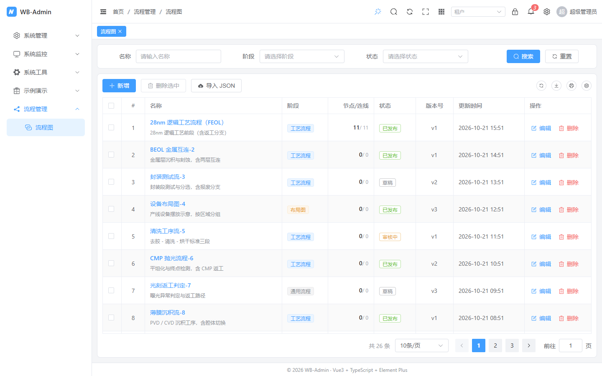
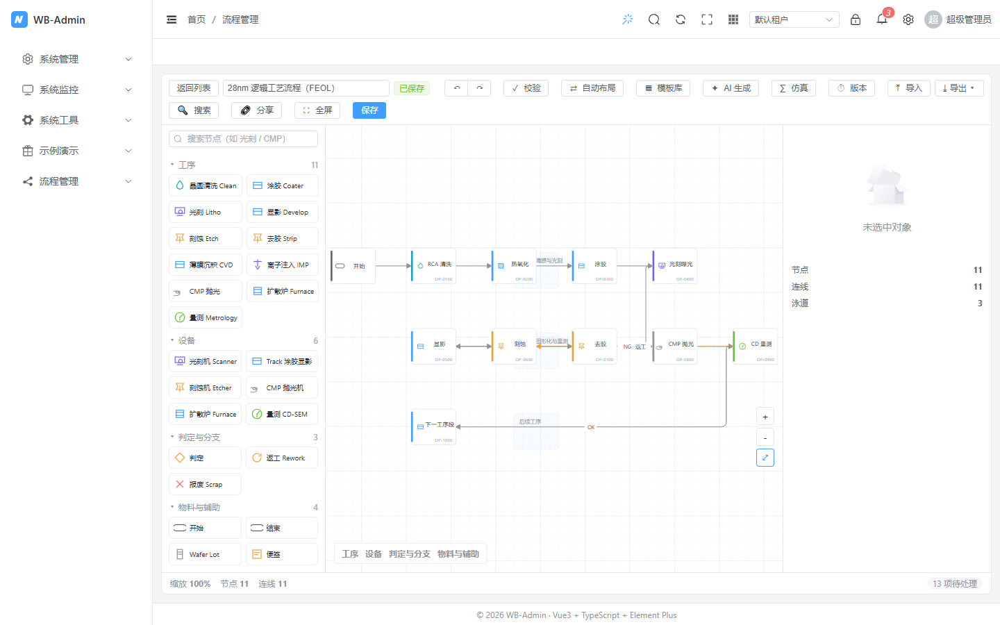

# FlowEditor 流程图编辑器

基于 [LogicFlow 2.x](https://site.logicflow.cn/) 的**可配置**流程图编辑器：拖拽建模、连线、属性面板、自动布局、校验定位、版本对比、模板、AI 生成、只读嵌入——同一套代码按 `preset` 档位与细项开关收缩成「极简嵌入」到「工艺全功能」两种形态。

- 需求文档：[流程图编辑器 PRD](/design/flow-editor)
- UI 原型：[flow-editor-ui.html](/design/flow-editor-ui.html)（可切档位、切元件库，实时看差异）
- 在线演示：`/flow/index` 列表 → 任一行的「编辑」。**编辑页不摆任何配置开关**——`preset` / `features` / `palette` 全部写在 `editor.vue` 的 `editorConfig` 里，想换就改代码（见下方「落地页怎么写」）

列表页沿用项目标准页写法（`SearchForm + ProTable + ProDialog/ProForm`），筛选、分页、列设置、导出与其它业务页一致：



编辑器页同样是 `.wb-page` 纵向 flex 布局：配置条固定、画布吃掉剩余高度，四周留白与其它页面一致（12px）：



## 为什么做成「可配置组件」

同一家公司里，流程图的用法差别很大：给车间看板嵌一个只读小图，跟给工艺工程师画 200 道工序的全图，不应该是两个组件。所以这里的做法是：

```
preset（mini / standard / pro）    ← 一层：先给个整体量级
      ↓ 覆盖
configureFlowEditor()（全局默认）   ← 二层：项目启动时统一微调
      ↓ 覆盖
<FlowEditor :config="{...}" />     ← 三层：单实例再改
      ↓
resolveConfig()  → ResolvedFlowConfig（唯一真源，组件内部只认它）
```

组件内部**不再到处写 `props.x ?? 默认值`**，只在 `resolveConfig()` 里合并一次，其余代码全部读 `cfg.value.xxx`。这样「某个开关在哪个场景生效」只有一个答案，不会出现「工具条以为关了、快捷键还开着」这类漏网。

> ⚠️ 布尔 prop 必须写 `default: undefined`。Vue 对 `type: Boolean` 的 prop 有内建布尔转换，声明了但没传就是 `false`，`props.x ?? 默认值` 的 `??` 永远走不到右边——这个坑本项目在 `ProDialog` 上踩过一次，`FlowEditor` 的 props 全部按这个规则写。

## 目录与职责

| 文件 | 职责 |
| --- | --- |
| `src/components/FlowEditor/index.vue` | 三栏壳：工具条 / 元件库 / 画布 / 属性面板 + 草稿恢复 + 离开保护 + `defineExpose` |
| `src/components/FlowEditor/config.ts` | 五张档位表（features / exports / palette / toolbar / inspector）+ `resolveConfig()` |
| `src/components/FlowEditor/types.ts` | 全部对外类型：`PaletteItem`、`FlowEditorOptions`、`ResolvedFlowConfig`、`FlowApi`… |
| `src/components/FlowEditor/palette.ts` | 内置元件库（半导体 24 / 基础 10 / 通用流程 5）+ `resolvePalette()` + `searchPalette()` |
| `src/components/FlowEditor/nodes.ts` | 自定义节点：`ProcessNode`、`DecisionNode`、`LaneNode`、`FlowEdge` + `registerNodes()` |
| `src/components/FlowEditor/serialize.ts` | 图数据 ⇄ LogicFlow 数据、版本迁移、未知类型降级、统计 |
| `src/components/FlowEditor/useFlowEditor.ts` | 编辑器核心：实例生老病死、事件同步、命令集（增删改 / 撤销 / 复制粘贴 / 布局 / 校验 / 定位） |
| `src/components/FlowEditor/useFlowDraft.ts` | 本地草稿（IndexedDB + localStorage 兜底 + 卸载 flush + 列表页清理） |
| `src/components/FlowEditor/useFlowExport.ts` | 导出 PNG / JPEG / SVG / JSON / Excel / 打印，导入 JSON |
| `src/components/FlowEditor/validate.ts` | 内置校验规则（7 条）+ `runValidate()` + `detectCycle()` |
| `src/components/FlowEditor/layout.ts` | dagre 自动布局（LR / TB）+ 网格吸附 |
| `src/components/FlowEditor/diff.ts` | 版本对比（新增 / 删除 / 修改 / 移动）+ 高亮色 |
| `src/components/FlowEditor/simulate.ts` | 节拍分析：总节拍、关键路径、瓶颈、良率传播（动态 `import`） |
| `src/components/FlowEditor/ai.ts` | 自然语言 → 图（动态 `import`，可替换为真实模型） |
| `src/components/FlowEditor/collab.ts` | 基于 `BroadcastChannel` 的同机多标签协同（动态 `import`） |
| `src/components/FlowEditor/templates.ts` | 内置模板（CMOS FEOL / BEOL / 封装 / 设备布局） |
| `src/components/FlowEditor/FlowPalette.vue` | 左侧元件库：搜索、折叠、拖拽、点击即加 |
| `src/components/FlowEditor/FlowInspector.vue` | 右侧属性面板：节点 / 连线 / 画布三态，参数表、设备绑定、评论 |
| `src/components/FlowEditor/FlowToolbar.vue` | 顶部工具条（按配置渲染，每项带 `data-test="tb-*"`） |
| `src/components/FlowEditor/FlowIssuePanel.vue` | 校验结果抽屉 + 仿真结果 Tab |
| `src/components/FlowEditor/FlowAdvancedDialogs.vue` | 版本 / 模板 / AI / 导入 Excel / 分享 / 搜索定位六个弹窗 |
| `src/components/FlowEditor/FlowViewer.vue` | 只读嵌入（E15）：`preset: 'mini' + readonly` 的一层糖 |
| `src/config/flow.ts` | 全局默认值 `flowDefaults` + `configureFlowEditor()` |
| `src/api/flow.ts` | 流程图接口（列表 / 详情 / 保存 / 草稿 / 版本 / 发布 / 回滚 / 导入） |
| `src/views/flow/index.vue` · `editor.vue` | 列表页（SearchForm + ProTable，支持名称/阶段/状态筛选、批量删除、导入 JSON）与编辑页（配置写在代码里，只保留「返回列表」） |

## 快速上手

最小可用：

```vue
<script setup lang="ts">
import FlowEditor from '@/components/FlowEditor/index.vue'
import type { FlowGraph } from '@/types'

const graph = ref<FlowGraph>()
onMounted(async () => {
  graph.value = await flowApi.detail('F1')
})
</script>

<template>
  <FlowEditor :graph="graph" flow-id="F1" height="100%" />
</template>
```

全功能（工艺编辑器）：

```vue
<FlowEditor
  :graph="graph"
  :flow-id="id"
  preset="pro"
  :config="{
    features: { collab: true, simulate: true, share: true },
    palette: { preset: 'semiconductor', searchable: true, collapsible: true },
    exports: ['png', 'jpeg', 'svg', 'json', 'excel', 'print'],
    persist: { draft: 'indexeddb', autoSaveRemote: true, leaveGuard: true },
    inspector: { showParams: true, showDevice: true }
  }"
  @save="onSave"
  @change="(g) => (current = g)"
  @ready="(api) => (apiRef = api)"
/>
```

只读嵌入（看板 / 分享页）：

```vue
<FlowViewer :graph="graph" height="320px" :interactive="false" />
```

### 落地页怎么写

配置属于代码，不属于界面——页面里不要摆「切档位 / 关功能」的开关条。参考 `src/views/flow/editor.vue`：

```vue
<script setup lang="ts">
/** 只声明一次，改配置就改这里；全站默认值在 src/config/flow.ts */
const editorConfig: FlowEditorOptions = { preset: 'pro' }
</script>

<template>
  <div class="wb-page">
    <div v-loading="loading" class="editor-wrap">
      <FlowEditor v-if="graph" :graph="graph" :flow-id="flowId" :config="editorConfig" @save="onSave" @change="onChange">
        <template #toolbar-left>
          <el-button size="small" @click="back">返回列表</el-button>
        </template>
      </FlowEditor>
    </div>
  </div>
</template>

<style scoped>
.editor-wrap {
  flex: 1 1 0;
  min-height: 400px;
  display: flex;
}
</style>
```

两个约定：容器用 `.wb-page`（留白只由 `.wb-app-main` 提供一次）；「返回列表」这类页面级操作放进 `toolbar-left` 插槽，编辑器自己的工具条不用改动。

## 配置项

### preset 三档

| | `mini` | `standard` | `pro` |
| --- | --- | --- | --- |
| 元件库 | 基础库（10） | 半导体（24） | 半导体（24） |
| 工具条 | 撤销/重做/导出/保存 | + 校验/布局/导入/搜索/全屏 | + 模板/AI/仿真/版本/分享 |
| 导出 | PNG/JSON | PNG/JPEG/SVG/JSON/打印 | + Excel |
| 属性面板 | 基础 + 备注 | 基础 + 备注 | + 工艺参数 + 设备绑定 |
| 适合 | 看板嵌入、只读分享 | 一般业务流程图 | 工艺工程师全功能 |

`mini` 之外的差异都在 `features` 里，档位只是给这 16 个开关一个合理默认值。

### features（16 项）

| 开关 | 说明 | mini | standard | pro |
| --- | --- | --- | --- | --- |
| `minimap` | 右下角缩略图 | ✗ | ✓ | ✓ |
| `autoLayout` | 自动布局（dagre） | ✗ | ✓ | ✓ |
| `validate` | 校验与定位 | ✗ | ✓ | ✓ |
| `version` | 版本发布 / 回滚 / diff | ✗ | ✗ | ✓ |
| `template` | 模板库 | ✗ | ✗ | ✓ |
| `lane` | 泳道 / 分组框 | ✗ | ✓ | ✓ |
| `lock` | 锁定与只读 | ✗ | ✓ | ✓ |
| `fullscreen` | 全屏 | ✗ | ✓ | ✓ |
| `ai` | 自然语言生成 | ✗ | ✗ | ✓ |
| `collab` | 协同编辑（需后端） | ✗ | ✗ | ✗ |
| `simulate` | 节拍 / 瓶颈分析 | ✗ | ✗ | ✗ |
| `comment` | 节点评论 | ✗ | ✗ | ✓ |
| `search` | 搜索与定位 | ✗ | ✓ | ✓ |
| `share` | 只读分享链接 | ✗ | ✗ | ✗ |
| `importExcel` | 导入 Excel 工序表 | ✗ | ✗ | ✓ |
| `legend` | 图例 | ✗ | ✗ | ✓ |

`collab` / `simulate` / `share` 即便 `pro` 档也默认关：它们要么依赖后端、要么只在特定业务里有意义，**要开就显式声明**。三者（含 `ai`）的代码都走动态 `import()`，开关关掉时对应 chunk 根本不会被请求。

`readonly` 会强制把一批开关置为 `false`（模板 / AI / 协同 / 评论 / 导入 Excel / 自动布局 / 版本）——只读视图里出现「改数据」的按钮是设计事故，这层保护写在 `resolveConfig()` 里，不靠调用方自觉。

### palette（元件库）

| 字段 | 说明 |
| --- | --- |
| `preset` | `'semiconductor' \| 'basic' \| 'generic'`，用内置库 |
| `groups` | 传了就**整体替换**内置库（自定义业务库走这里） |
| `extend` | 在内置库上追加 / 覆盖（同 `type` 覆盖，新 `type` 追加） |
| `exclude` | 按 `type` 剔除 |
| `searchable` | 顶部搜索框（默认 true） |
| `collapsible` | 分组可折叠（默认 true） |
| `draggable` | 可拖拽到画布（默认 true；`readonly` 时强制 false） |
| `quickAdd` | 点击即加（默认 true） |

`PaletteItem` 字段：

```ts
{
  type: 'litho',          // 唯一标识，也是节点的 type，落库后不要随便改
  label: '光刻 Litho',    // 显示名
  icon: 'litho',          // icons.ts 里的图标 key
  color: '#7c5cff',       // 节点主色（描边 / 图标底色）
  keywords: ['photo', 'scanner'], // 搜索命中词（中英文都放）
  shape: 'rect' | 'diamond' | 'round' | 'note',
  size: { width: 140, height: 56 },
  defaults: { code: 'OP-', bay: 'PHOTO' }, // 拖进来就带上的属性
  next: ['etch', 'metro'],// 推荐后继（校验 next-whitelist 用）
  disabled: false
}
```

三条硬约束：

1. **不在库里的 `type` 不会注册成节点**——所以换了自定义库之后，旧图里那些类型会降级成通用 `task`（`toLfData` 会返回 `unknownTypes`，界面给一条提示，不静默丢节点）。
2. `type` 一旦落库就是主键语义，改名前先做数据迁移。
3. `readonly` 下 `draggable` 被强制关闭，但库本身仍可展示（只读看板也要图例）。

### toolbar / exports / inspector / persist

```ts
toolbar: {
  items: ['undo', 'redo', 'validate', 'save',          // 内置动作
    { action: 'export', icon: 'Download', label: '下载' }] // 或覆盖图标/文案
}
// 内置动作：undo redo validate layout export import save fullscreen
//           version template ai collab simulate search share

exports: ['png', 'jpeg', 'svg', 'json', 'excel', 'print']
imports: true

inspector: {
  fields: [{ key: 'recipe', label: 'Recipe', type: 'text', required: true, unit: '' }],
  showParams: true,   // 工艺参数表（CT / 良率 / 设备数）
  showDevice: true,   // 设备绑定（接 DeviceTree）
  showRemark: true,
  showBasic: true
}

persist: {
  draft: 'indexeddb' | 'local' | false,
  autoSaveRemote: false,   // 有后端时开：变更后 5s 落远端
  debounce: 500,
  leaveGuard: true
}
```

### 其他

| 配置 | 默认 | 说明 |
| --- | --- | --- |
| `readonly` | `false` | 只读：无元件库、无拖拽、无文本编辑、无撤销 |
| `interactive` | `true` | 关掉后连缩放平移都锁死（静态图） |
| `gridSize` | `20` | 网格尺寸，也是对齐吸附步长 |
| `validateRules` | `[]` | 追加自定义校验规则 |
| `height` | 撑满容器 | 画布高度 |

## Props / Events / Expose

**Props**

```ts
config?: FlowEditorOptions
graph?: FlowGraph          // 不传则读草稿，再没有就是空白图
flowId?: string            // 草稿 key 的一部分
readonly?: boolean
height?: string
```

**Events**

| 事件 | 时机 |
| --- | --- |
| `ready(api)` | 实例就绪，拿到命令式 API |
| `change(graph)` | 任何数据变化（含拖动、连线、改属性） |
| `save(graph)` | 显式保存（`Ctrl+S` / 保存按钮 / 自动保存远端） |
| `validate(issues)` | 手动校验完成 |
| `node-click(node)` | 选中节点 |
| `update:name(name)` | 工具条里改图名 |

**Expose（`FlowApi`）**

```ts
getGraph(): FlowGraph
setGraph(graph): void
validate(): FlowIssue[]
autoLayout('LR' | 'TB'): void
export(type): Promise<void>
clear(): void
undo(): void
redo(): void
focusNode(id): void
addNode(item, position?): string
getSelected(): { nodes: FlowNode[]; edges: string[] }
```

## 本地草稿与保存

```
任何变更 → draft.save(graph)  ──500ms 防抖──→ IndexedDB（写纯 JSON，不是 proxy）
   │                              ↑ 失败降级 localStorage（去掉缩略图再试一次）
   └─ pagehide / beforeunload / visibilitychange → flush() 强制落盘
```

重进编辑页时的恢复判定**不是**「有没有传 `graph`」，而是「草稿跟当前图比一比」：

- 两者一致 → 草稿没意义，直接删掉（否则每次进来都弹框）；
- 有差异 → 弹确认框「恢复 / 丢弃」，恢复后提示已恢复。

比对口径要包含 **图名、泳道、备注**——只比节点和连线的话，「只改了图名」会被判成没差异，草稿被静默删除。这条是实测踩出来的（`diffGraph` 只管节点/连线，元信息得单独比）。

离开保护（F13）：`dirty` 且有 `leaveGuard` 时，路由离开弹「保存并离开 / 直接离开」，`beforeunload` 交给浏览器原生提示。选「直接离开」会顺手删掉草稿——不然下次进来又弹一次，用户会觉得没生效。

保存成功后 `doSave()` 会清草稿；列表页也可用 `clearDraft(flowId)` / `listDrafts()` 批量处理。

> 一个必须记住的坑：Vue 的响应式 proxy **不能被 IndexedDB 结构化克隆**，直接 `put(proxy)` 会「返回成功但读不到」。落盘前必须 `JSON.parse(JSON.stringify(graph))` 转纯对象。

## 导出

| 类型 | 实现 | 备注 |
| --- | --- | --- |
| PNG / JPEG / SVG | LogicFlow `Snapshot` 插件 | 节点全用 SVG 画，不依赖页面 CSS，导出的图跟屏幕一致 |
| JSON | 序列化 `FlowGraph` | 带 `schema: 1`，导入时按版本迁移 |
| Excel | 复用 `src/utils/excel.ts`（`xlsx`） | 一行一道工序：编号 / 名称 / 类型 / 设备 / CT / 良率 |
| 打印 | 复用 `src/utils/print.ts`（隐藏 iframe + `window.print()`） | 打印区间只有画布本身 |

节点不用 `HtmlNode`（`foreignObject`）是刻意的：`Snapshot` 拿 `outerHTML` 画图，页面 CSS 一旦没带上，导出的图就散架。纯 SVG 绘制让「所见」和「所得」共用同一份形状定义。

## 校验

内置 7 条规则，全部返回 `FlowIssue`（`code / level / message / nodeIds`），点一下就能定位到画布并高亮：

| code | 说明 |
| --- | --- |
| `isolated` | 孤立节点（无入无出） |
| `no-entry` | 无入口（有入边但没有任何起点） |
| `no-exit` | 无出口 |
| `cycle` | 存在环路（返工边除外） |
| `duplicate-code` | 工序编号重复 |
| `missing-name` | 未命名节点 |
| `next-whitelist` | 连线不在推荐后继里（工艺顺序可疑） |

自定义规则（会被追加到内置规则之后）：

```ts
const myRule: ValidateRule = {
  code: 'recipe-required',
  label: '必须填 Recipe',
  run: (graph) =>
    graph.nodes
      .filter((n) => n.properties?.kind === 'process' && !n.properties?.recipe)
      .map((n) => ({ code: 'recipe-required', level: 'error', message: `${n.text} 缺 Recipe`, nodeIds: [n.id] }))
}
```

## 扩展点

**自定义节点**：`nodes.ts` 里 `ProcessNode` 继承 `RectNode`，形状全在 `ProcessNodeView` 的 SVG 里。容易踩的坑是「子类字段在父类构造期还没赋值」——`setAttributes()` 在父类构造时就调了，此时 `this.defs` 是 `undefined`。所以 `createProcessModel(defs)` 用**闭包**把默认值传进去，而不是存成 `this.defs`。

**i18n**：全部文案走 `flow.*` 命名空间（中英两份同步）。新增文案时 `zh-CN.ts` 和 `en-US.ts` 必须同时加，否则另一边会显示 key。

**AI / 协同 / 仿真**：三者都是「可选能力」，接口留在 `ai.ts` / `collab.ts` / `simulate.ts` 里，组件只依赖它们返回的数据结构。换成真后端时改这三个文件即可，`index.vue` 一行不用动。

**只读分享（E11）**：`buildApi()` 里生成分享链接，页面本体是 `/flow/editor/:id?readonly=1`——同一个组件、同一份数据，只切 `readonly`。

## 测试

| 文件 | 覆盖 |
| --- | --- |
| `test/unit/flow-editor.spec.ts` | 31 个：配置三层合并、元件库解析与搜索、序列化与未知类型降级、7 条校验、dagre 布局、diff、仿真关键路径/良率、模板与 AI 兜底 |
| `test/e2e/flow-editor.spec.ts` | 11 个：列表页、列表页筛选/重置/新建、拖拽建节点、改名→切走→回来草稿恢复、代码配置（pro 档按钮 + 半导体库）、只读（走 `?readonly=1`）、返回列表、校验面板、导出 JSON、全屏下浮层仍在渲染树内、留白与标准页一致 |
| `test/unit/page-template-root.spec.ts` | 2 个：所有页面模板的根节点唯一（不允许注释抢在根节点前） |

纯函数（配置 / 序列化 / 校验 / 布局 / diff / 仿真）全部放在无 DOM 依赖的模块里，单测跑得快也稳；e2e 只覆盖「浏览器里点得到、看得见」的部分。

跑法：

```bash
npx vitest run test/unit/flow-editor.spec.ts
npx playwright test test/e2e/flow-editor.spec.ts
```

## 常见坑

1. **布尔 prop 不写 `default: undefined`** → 全局默认失效（Vue 内建布尔转换，详见开头）。
2. **`width` / `height` 只有 getter** → 想改尺寸只能走节点数据 / `setAttributes`，不能直接赋值。
3. **`draggable` 不能用 getter 覆盖** → TS2611，只能在 `setAttributes()` 里赋值。
4. **父类构造期调 `setAttributes()`** → 子类字段此刻还没赋值，默认值走闭包。
5. **响应式 proxy 进 IndexedDB 会静默失败** → 先 `JSON.parse(JSON.stringify())`。
6. **泳道标题为空** → `toLfData` 要把 `name` 写进 `properties`，`fromLfData` 才能回读。
7. **编辑页保存用了初始 `graph` 引用** → 必须用 `@change` 维护的 `current`，否则保存的是进来时那份。
8. **工具条图名输入框被 flex 压成 3px** → `.wb-flow-toolbar { flex-wrap: wrap }` + `.fname { flex: none }`。
9. **`diffGraph` 不比元信息** → 图名 / 泳道变更要单独判，否则草稿比对会漏。
10. **改 `preset` 后旧图不认新类型** → `unknownTypes` 会提示降级，别当没发生。
11. **全屏后弹窗"显示不出来"** → 原生全屏只渲染 `fullscreenElement` 这棵子树，而 Element Plus 的弹窗 / 抽屉 / 消息 / 下拉全部 teleport 在 `body` 上，容器全屏时它们都在树外（DOM 还在、尺寸也有，就是用户看不见）。解法是**把全屏目标抬到 `document.documentElement`**，再用 `position: fixed; inset: 0` 让编辑器铺满视口——浮层依旧在树内且 `z-index` 从 2000 起，会正常盖在编辑器之上。
12. **全屏切换不会触发 `window.resize`** → 别指望 resize 监听去重算画布。LogicFlow 内部有 `ResizeObserver` 观察容器，尺寸变化会自己 `resize()`；额外的手动 resize 是冗余的。
13. **列表页筛选条件传空串等于没筛** → 组装查询参数时要 `if (value)` 逐个挑，空串会把 `name=''` 发出去（当前实现里 mock 会忽略空值，但真实后端不保证）。
14. **落地页别再给容器加 `padding`** → 全站留白只由 `.wb-app-main` 提供一次（`--wb-content-padding: 12px`），页面容器一律用 `.wb-page`。自己再套一层 `padding: 12px` 就把四周留白变成 24px，编辑器这种"大色块"组件会让偏差格外明显。
15. **页面模板的根节点必须唯一** → 在根节点前写一行 HTML 注释，组件就变成多根节点；`.wb-app-main` 的 `<transition mode="out-in"> + <keep-alive>` 拿不到单一子元素，**离开该页之后所有页面都空白**（URL 变了、路由也匹配了，就是不渲染，且零报错）。dev 下注释不剥离，生产构建里自动消失，所以只能在源码层挡住（`test/unit/page-template-root.spec.ts`）。
16. **编辑器高度别用 `calc(100vh - 220px)`** → 220 是照着当时的顶栏 + 配置条 + 页脚硬凑的，换布局 / 加页签 / 窗口缩放立刻溢出或留空。正解是让页面纵向 flex：`.wb-page`（`height: 100%`）→ 配置条 `flex: none` → 编辑器容器 `flex: 1 1 0; min-height: 400px`，`height` 不传即 `100%`。`min-height` 只是兜底：视口太矮时页面自己滚，别把画布压扁。
